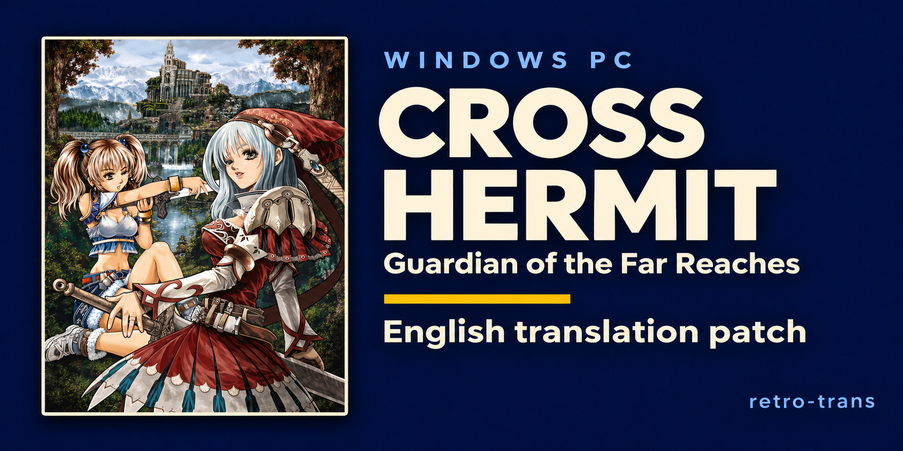

# Cross Hermit — translation project

English translation and modern Windows support for **Cross Hermit: Guardian of the Far Reaches**.

## Contribute

The first public version is ready to play, but we have not tested every mission or hardware configuration. Bug reports, proofreading and playtesting are welcome. Join the retro-trans Discord:

**[discord.gg/MssepShjmB](https://discord.gg/MssepShjmB)**

You can also [open an issue](https://github.com/retro-trans/cross-hermit/issues). Include the installed version, what happened, steps to reproduce it and a screenshot where possible.

## Play it

The latest release is **[v0.8.0](https://github.com/retro-trans/cross-hermit/releases/tag/v0.8.0)**, with an ISO xdelta package for fresh installations and launcher updates for supported existing English installations.

It includes English dialogue and interface text, widescreen and text improvements, updated battle controls, optional support Auto casting, and compatibility and gameplay fixes. **This patch includes gameplay adjustments as well as translation.** A complete live playthrough remains pending.

### Apply

| What you have | What to use |
| --- | --- |
| Original Japanese `EB2002CH.iso` | Retro Trans **Automatic**, or `Cross-Hermit-0.8.0-ISO-patch.zip` |
| Supported English installation, game version 0.1.261 or 0.1.264 | **Check for updates** in `Launcher.exe` |

**Fresh installation**

With [Retro Trans Tools](https://github.com/retro-trans/retro-trans-tools/releases/latest), open **Automatic**, click **Refresh catalog**, browse to your original `EB2002CH.iso`, select **Latest** (0.8.0), and choose a new `.iso` output with **Original format**. Click **Patch**; the app downloads the matching xdelta and verifies both source and output. Mount the resulting ISO and run `SETUP.EXE`.

To use the standalone package instead:

1. Download and extract `Cross-Hermit-0.8.0-ISO-patch.zip` from the release.
2. Run `Patch Cross Hermit.cmd`. Select your original Japanese ISO and choose a new output filename.
3. Mount the patched ISO and run `SETUP.EXE`. Choose a new folder on your hard drive.
4. Open **Cross Hermit English** from its desktop/Start menu shortcut, or run `Launcher.exe` in the installed folder.

**Using Retro Trans Tools:** extract the same ISO patch ZIP, open [Retro Trans](https://github.com/retro-trans/retro-trans-tools/releases/latest), and select **Apply xdelta**. Choose your original `EB2002CH.iso`, the extracted `Cross-Hermit-English-0.8.0.xdelta`, and a new output filename ending in `.iso`. Keep **Output format: Original format**, then apply the patch. Mount the resulting ISO and run `SETUP.EXE` as above. See the [tested steps and expected output hash](docs/RETRO-TRANS.md).

You need your own original disc image. The patch expects this exact source; keep checksum verification enabled:

| Source | Expected value |
| --- | --- |
| Filename | `EB2002CH.iso` |
| Size | 659,390,464 bytes |
| SHA-256 | `34a7a1da0e9bb9da44a7397d6873d91d72bced5229ca0cb46d1555f0f95a93f9` |

The patched ISO contains the complete current translation, Windows Forms setup and launcher, native uninstaller and game-local Japanese locale runtime. No separate Locale Emulator installation or system-locale change is needed. Unmount the ISO after installation if you wish; the installed game does not need it.

Requirements: Windows 10/11 on 64-bit Intel/AMD, Windows PowerShell 5.1 and .NET Framework 4.x. Setup needs at least 2.3 GB of free space.

**Existing English installation**

Open `Launcher.exe`, choose **Check for updates**, then install the update with the game closed. Reopen the launcher afterward.

Version 0.8.0 supports English game versions **0.1.261** and **0.1.264**. Installations made with installer revisions 0.1.262/0.1.263 report game version 0.1.261 and are supported too. Other installations should use the fresh-install route. The updater does not support unmodified Japanese installations.

The launcher downloads `Cross-Hermit-update.json` and `Cross-Hermit-0.8.0-update.zip`. Use the launcher to apply these assets: it validates the installation and checksums, backs up replaced files and preserves saves and personal settings.

### What is included

- English dialogue, interface text and offline Skills / Classes & upgrades guides in the launcher.
- Widescreen rendering, readable text, corrected interface layouts and two-line item names.
- Ctrl/Shift selection, Ctrl+A, same-class double-click selection and tactical pause.
- Updated skill targeting and optional local support Auto casting, including group support controls.
- Crash, casting-state, stat-calculation, rendering and performance fixes.
- BAD damage over time reduced by 75%, enemy healing reduced by 50% and Wisp HP reduced by 75%.
- Automatic targeting that prefers enemies over destructible walls unless a wall is explicitly targeted.

### Basic battle controls

| Action | Control |
| --- | --- |
| Select | Left-click or drag |
| Add/remove selection | Ctrl or Shift with selection |
| Select all deployed allies | Ctrl+A |
| Select the same class | Double-click a deployed ally or its portrait |
| Move / normal attack | Right-click ground / an enemy |
| Use a skill | Click its icon or press F1-F8, then left-click a valid target |
| Cancel targeting | Right-click |
| Deploy reserves | Select a reserve portrait, then left-click a deployed ally |
| Tactical pause | Space |

### Saves and uninstall

Saves live in the installation's `SaveData` folder. Close the game before copying them, and keep a separate backup before reinstalling or moving to another computer.

Uninstall from Windows Apps, the Start menu or `Uninstall.exe`. The uninstaller first copies and verifies saves, settings and unrecognized files to **Documents/Cross Hermit Backups**, then removes the owned installation. Restore the backed-up `SaveData` folder into a new installation to continue your progress.

## What is here

| Path | Contents |
| --- | --- |
| `src/` | Current launcher, uninstaller, setup, extraction and disc-support sources |
| `translation/en/` | Three English-only tutorial exports for the revised battle controls |
| `docs/assets/` | Social-preview artwork and its generation prompt |
| `docs/RETRO-TRANS.md` | Verified Retro Trans Tools ISO-patching instructions |
| `CHANGELOG.md` | Public release changes and validation summary |

This repository contains release documentation, current tool source and selected English exports. The complete local translation toolchain and script collection are not published here. It contains no game ISO, original Japanese script dump, saves or account credentials. GitHub's automatic source archive is the repository snapshot at the release tag; use the release's ISO patch package or launcher updater to play.

## Do not sell this

This patch is free. Do not sell it or anything made with it: no pre-patched discs or images, no paid installations, and no paywalled or ad-gated downloads.

This is an unofficial fan translation. Original game content and artwork belong to their respective rights holders. The separate licenses for published tool source and bundled components still apply.

## Credits

| Role | Contributor |
| --- | --- |
| Project direction and playtesting | [binhlt0402](https://github.com/binhlt0402), retro-trans |
| Translation, editing, tooling and reverse engineering assistance | OpenAI Codex, directed by the project lead |

The translation is machine-produced with large language models and then edited, rather than a hand translation by a fluent translator. Names and terminology follow the project's glossary. Review uses accuracy checks, an editorial pass for clarity and character voice, and final proofreading; substantive wording changes are checked again for meaning.

Thanks to the creators of the bundled locale runtime, fonts, graphics compatibility components and patching/extraction tools. Their notices and applicable source archives accompany the distributed components. `src/LICENSE.txt` covers the new project tools only.

The social-preview composition was generated from supplied Cross Hermit artwork using an image-generation tool.

## Status

**v0.8.0 is the first public 0.x test release.** See [CHANGELOG.md](CHANGELOG.md) and the [release notes](https://github.com/retro-trans/cross-hermit/releases/tag/v0.8.0) for what is included and what was checked.

Validation covers exact ISO reconstruction, fresh setup and uninstall, updater safety and rollback, preservation of synthetic saves/settings, compiled application tests and native HUD checks. These checks do not establish that every mission, opening sequence or hardware configuration works correctly.

The published ISO patch ZIP was also downloaded without credentials and applied through Retro Trans 0.5.21's **Apply xdelta** engine. Its output matched the complete release ISO size and SHA-256 hash, with the original preserved.

Retro Trans **Automatic** was verified with the public catalog and clean download caches, including the released Windows 0.5.21 app's Automatic command. It recognized the original, downloaded the matching patch, verified the exact English ISO and recognized that output as current. See the [verification records](docs/validation/retro-trans-automatic.json).

### Human proofreading

There is no audited human proofreading line count for this project yet. Machine review passes are not counted as human proofreading, and a complete human review against the Japanese has not been established. Reports and playtesting have informed corrections; further review is welcome through Discord or GitHub issues.
